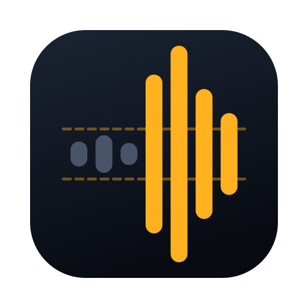

# Squelch



把 YouTube 頻道當 podcast 聽的 macOS App。只抓音軌，不解碼影片，不用登入。

名字取自無線電的靜噪（squelch）：把雜訊切掉，只留人聲。

## 功能

- 訂閱頻道（`@handle`、頻道網址、`UC…` 頻道 ID），每 30 分鐘自動抓新影片
- 「最新」「聽到一半」「待播清單」三個清單，待播清單可以拖拉排序
- 播放器在視窗右側的「正在播放」面板（工具列最右邊的按鈕收合）：進度條標出 SponsorBlock 片段、時間碼用等寬字、倍速一排點了就換、待播清單接在下面
- 播放速度 1×–3×（語音用 time-domain 變速，不會變調）
- 音量 0–200%（⌘↑ ⌘↓，喇叭圖示點了靜音）。超過 100% 是放大，拉過去就生效，加柔性限幅不爆音
- 記住每部影片聽到哪裡，下次從那裡接著聽
- SponsorBlock 自動跳過贊助片段（設定裡可再開自我宣傳、訂閱提醒）
- 控制中心的「正在播放」、媒體鍵、耳機按鍵
- 關掉視窗照樣在背景播，選單列有控制
- 搜尋 YouTube（工具列，按 Enter 才查），右鍵可以把結果的頻道加進來
- 觀看記錄：登入時是 YouTube 的觀看記錄（手機上看的也在），沒登入是 Squelch 自己的播放記錄
- 貼影片網址直接播（直播回放、沒訂閱的頻道）
- 正在直播的會標「直播中」排在最上面，可以直接聽。「直播中」清單檢查你勾選的頻道（設定或頻道右鍵），每 10 分鐘自動查一次：打開頻道的 `/live` 網頁看播放器資料的 `isLive`，一個頻道一個請求，不用 yt-dlp、不帶帳號（頻道 RSS 在 2026/11 已經 404）。`/live` 只給頻道主要的那一場，同時開好幾場只會抓到一場
- 介面有正體中文、English、日本語、简体中文，跟著系統語言；其他語言顯示英文
- 登入 YouTube（選用）：多一個「訂閱動態」，播放紀錄和進度會回報給 YouTube，網頁版和手機可以接著看

## 下載

[GitHub Releases](https://github.com/jason5545/Squelch/releases/latest) 有 Developer ID 簽章、Apple 公證過的版本，解壓縮後拖進「應用程式」就能開。介紹頁：<https://squelch.hiroki.im/>

## 需求

- macOS 26（Apple Silicon）

不用另外裝任何東西：yt-dlp 和它解 YouTube 需要的 JS 執行環境 deno 都包在 App 裡（見「內建的 yt-dlp」）。

## 建置

```sh
make build      # xcodegen + xcodebuild，產物在 build/xcode/Build/Products/Debug/Squelch.app（第一次會下載 yt-dlp 和 deno）
make run        # 建置後打開
make selftest   # 不開視窗，實際連 YouTube 跑核心流程
scripts/release.sh 0.1.0   # Developer ID 簽章＋公證，產出 build/dist/Squelch-0.1.0.zip
scripts/install.sh 0.1.0   # 裝到 /Applications/Squelch.app
scripts/ship.sh            # 一鍵：小版號加一、發公證版、安裝、打 git tag、發 GitHub Release（T3 的「發版並安裝」按鈕）
```

## 怎麼播的

1. `yt-dlp --flat-playlist -J <頻道>/videos` 抓清單（約 0.6 秒）。
2. 按下播放時 `yt-dlp -f 234/233 -j` 解出 HLS 純音訊的網址（約 2 秒）。
3. Squelch 自己播這個 HLS（`SegmentPlayer`）：抓播放清單和分段、解碼成 PCM、放大，再交給 `AVSampleBufferAudioRenderer`。約 1 秒就緒；先抓好後面 2 分鐘，在這個範圍裡跳轉約 0.5 秒。變速由系統做，跟 AVPlayer 同一個 time-domain 演算法。
4. 直播交給 AVPlayer 播同一個 HLS 網址。
5. 沒有 HLS 的影片，改用 yt-dlp 把 m4a 下載到 `~/Library/Caches/Squelch/audio/`，用 AVFoundation 重新封裝（不轉碼，見下面「分段式 MP4」那條）後交給 AVPlayer 播（16 分鐘的影片約 2 秒）。快取一週沒用就刪。

為什麼 HLS 不直接交給 AVPlayer：AVPlayer 播 HLS 時沒辦法在音訊路徑上加增益，音量最大就是 100%（見「音量放大」）。YouTube 的 HLS 純音訊分段其實很單純（2026/11/11 實測兩個頻道）：

- 播放清單是一般的 `#EXTINF` 加網址，分段不是 MPEG-TS，是「ID3 標籤 + ADTS AAC」，每段約 5 秒、80 KB，系統內建的 AAC 解碼器直接認得，不需要 ffmpeg。
- 分段照順序連續解碼，邊界沒有斷點：6 段 31 秒的音訊跟 ffmpeg 解同一段對照，位移 0、差異 RMS 0.00002。解碼 31 秒花 21 毫秒。
- 分段的起點用 `#EXTINF` 累加，跟分段裡 ID3 的時間戳最多差 22 毫秒。
- 格式不是這樣（哪天 YouTube 改成 fMP4、播放清單沒有結尾）就退回 AVPlayer 播 HLS，那一集的放大改走下面的下載備援。

為什麼不直接串流 m4a 直連網址（2026/11/11 實測）：

- googlevideo 對開放式 Range（`bytes=0-`）限速，6 秒只給約 200 KB；要自己切成有上限的 Range。
- 直連網址解出來後要等幾秒才能用（yt-dlp 的 `available_at`），太早請求回 403。
- 原始的 DASH m4a 是分段式 MP4：AVPlayer 要把整個檔案讀完才開播（45 分鐘的影片 12 秒），而且會把長度算成兩倍（1011 秒變 2023 秒），續播位置和 SponsorBlock 的時間點都會錯。以前靠 yt-dlp 叫 ffmpeg 修正容器；現在 App 不帶 ffmpeg，下載時加 `--fixup never`，再用 `AVAssetExportSession` 的 passthrough 重新封裝成一般的 m4a：同一個 1011 秒的檔案花 0.04 秒，修正後長度 1011.58 秒（ffprobe 1011.62 秒）。
- 有些頻道的直播回放不在 `/streams` 分頁，所以頻道預設不抓直播分頁（右鍵可開），直播回放用「播放影片網址」。

## 音量放大

YouTube 講話影片比 Spotify 小聲：實測兩部 Theo 影片 -20.6、-21.2 LUFS，Spotify 標準是 -14 LUFS，差約 7 dB。

AVPlayer 的音量最大 100%，要更大聲只能在音訊路徑上加增益（`MTAudioProcessingTap`）。但 HLS 串流不經過這條路（實測處理函式被呼叫 0 次）。0.6 以前的做法是拉過 100% 時把整個音軌下載下來、切到本機檔再放大：48 分鐘的影片要等 13 秒，中間還要換一次播放來源。現在改成自己解碼（見「怎麼播的」），PCM 在手上，直接乘：

- 100% 以下用 renderer 的音量，立刻生效。超過 100% 的部分在送進 renderer 之前乘上去。
- 送進去的音訊改不了，所以改增益時把排隊中、還沒播的換掉（`flush(fromSourceTime:)`），播放不中斷。renderer 內部已經取走約 1～1.5 秒（實測：替換點排在 1 秒後會失敗、1.5 秒後成功，1～3 倍速都一樣），所以往上調大約 1.6 秒（影片時間，2 倍速就是 0.8 秒）後才聽得到；往下調時，舊增益的音訊還在播的這段時間先把 renderer 的音量按比例壓低，立刻生效。
- 增益之後加柔性限幅：0.85 以下原樣，以上用 tanh 壓到不超過 1.0。原始峰值已經到 -2～-3 dBFS，不限幅一放大就爆音。實測一部 Theo 影片放大到 200% 時，只有 0.015% 的取樣會碰到限幅區。
- YouTube 自己的「穩定音量」音軌（itag `140-drc` 這類）幫不上忙：HLS 沒有這種音軌，只有 DASH 有，而且實測只大 1.9 dB（-18.7 對 -20.6 LUFS）。
- 快取裡有的影片、沒有 HLS 的影片播的是本機檔，用 `MTAudioProcessingTap` 放大，也是立刻生效。
- 直播由 AVPlayer 播，最大就是 100%。
- 備援：HLS 的格式 `SegmentPlayer` 解不了、退回 AVPlayer 的時候，照舊的做法背景下載音軌、從同一個位置切到本機檔。

## 內建的 yt-dlp

- `scripts/vendor-tools.sh` 下載官方發行檔並核對 SHA-256：yt-dlp 的 onedir 版 `yt-dlp_macos.zip`（PyInstaller 打包，內含 Python 和解 YouTube 用的 yt-dlp-ejs），以及 deno。版本寫在腳本裡。
- 只留 arm64，yt-dlp 約 44 MB、deno 約 77 MB；App 從約 5 MB 變成 126 MB，發版的 zip 從 2.3 MB 變成約 64 MB。
- 建置時 `scripts/embed-tools.sh` 把 deno 放 `Contents/Helpers`、yt-dlp 整包放 `Contents/Resources/yt-dlp`（裡面混著 `cacert.pem`、`.js` 這類資料檔，放在 Helpers 會被 codesign 當成沒簽章的程式），每個 Mach-O 用 hardened runtime 簽章。發版時 `xcodebuild -exportArchive` 會把裡面 106 個 Mach-O 全部重簽成 Developer ID，再一起公證。
- yt-dlp 從 PATH 找 JS 執行環境，Squelch 給它的 PATH 只有 `Contents/Helpers` 和系統目錄，有沒有裝 Homebrew 結果都一樣。
- 不帶 ffmpeg：只有下載備援用得到，改用 AVFoundation 重新封裝（見「怎麼播的」）。
- 自動更新：YouTube 一改版，舊的 yt-dlp 就抓不到。Squelch 每天到 GitHub 查一次 yt-dlp 的最新版（yt-dlp 失敗時最多每小時查一次），比使用中的新就下載 `yt-dlp_macos.zip`、核對 `SHA2-256SUMS`、實際跑一次 `--version`，都對了才放到 `~/Library/Application Support/Squelch/yt-dlp/`。App 本體不動，簽章不會壞；內建的和下載的兩份，用版本較新的那份。設定裡可以手動檢查，也可以指定自己的 yt-dlp。

## 登入

做法參考 [Kaset](https://github.com/sozercan/kaset)：App 內開 Google 登入頁，cookie 存在 Squelch 自己的 WebKit 資料區，跟瀏覽器分開。登入頁會藏掉 passkey（內嵌網頁的 passkey 一定失敗，見 Kaset ADR-0033），Google 會改走密碼。

帳號只用在三件事：

- 訂閱動態：`yt-dlp --cookies` 抓 `youtube.com/feed/subscriptions`，只在打開「訂閱動態」或按重新整理時抓，距上次超過 10 分鐘才抓。yt-dlp 跑完會把輪換過的 cookie 寫回檔案，Squelch 再讀回 WebKit。
  （不改成匿名一個一個抓頻道：訂閱幾百個頻道時，每輪幾百個請求，會超過 YouTube 對不登入的限流，連音軌和搜尋都會卡住。頻道 RSS 在 2026/11 已經回 404。）
- 觀看記錄：`yt-dlp --cookies` 抓 `youtube.com/feed/history`，只在打開清單或按重新整理時抓。
- 播放紀錄：從登入狀態的影片頁取得 `playbackTracking` 的兩個回報網址，開始播時送 `videostatsPlaybackUrl`（進觀看記錄）；暫停、跳轉、聽完、換集時，以及播放中每 5 分鐘，送 `videostatsWatchtimeUrl`（帶真正的位置）。45 分鐘的影片大約 10 次回報。參數照 yt-dlp 的 `_mark_watched`，但不會一律標成看完。

每 30 分鐘的自動更新完全不碰帳號（自我測試會檢查）；平常使用時帶帳號的請求只有播放紀錄回報，每部影片約 10 次，其他都是你打開或按了才抓。解析音軌和搜尋不帶帳號。yt-dlp 官方提醒：帳號搭配 yt-dlp 有被封鎖（暫時或永久）的風險，所以帶帳號的請求越少越好。

## 資料

- `~/Library/Application Support/Squelch/library.json`：頻道、影片、進度、待播清單。第一次打開沒有任何頻道，從右上角的 + 加入。
- `~/Library/Application Support/Squelch/cookies.txt`：登入後給 yt-dlp 的 cookie（權限 0600），登出就刪。
- `~/Library/Application Support/Squelch/yt-dlp/`：自動更新下載的 yt-dlp，刪掉就回到內建的那份。
